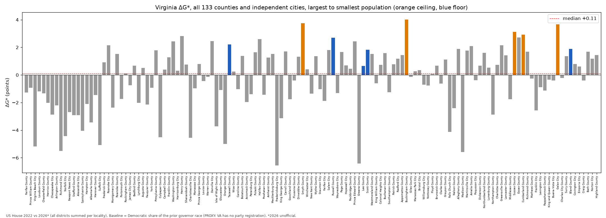
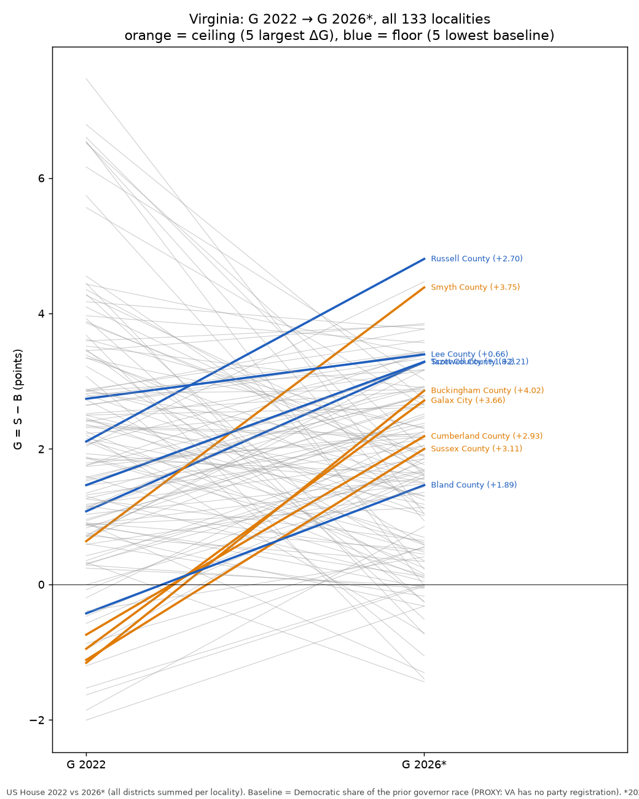

# Floor and Ceiling Localities

> **\*2026 figures are unofficial.** The Virginia State Board of Elections has not certified the November 3, 2026 general election. The Department of Elections (DOE) results site, enr.elections.virginia.gov (2026 November General), still labels them unofficial results; the files used here were published there on Nov 19, 2026 at 11:27 AM CST. 2022, 2021 and 2025 figures are certified. **PROXY BASELINE: Virginia has no party registration.** Where the other state wikis use the Democratic registration share, these pages use **B** = the Democratic share of the governor vote in the odd-year election just before each midterm (2021 for 2022, 2025 for 2026). It is not a count of registered Democrats. **Race: US House**, all 11 districts summed per county or independent city (Virginia had no governor, General Assembly or statewide race in 2022). Votes are votes for the Democratic candidate. These pages measure a pattern; they make no claim about intent, fraud or cause.

## How to read floor and ceiling localities

Look for the pattern at both ends. The ceiling localities are the ones with the highest ΔG; in Virginia those are Buckingham County, Smyth County, Galax City, Sussex County, Cumberland County. The floor localities are the most Republican baseline localities, where there were the fewest Democrats to move.

- **The floor** by ΔG is the single locality with the lowest ΔG in the state. In Virginia that's Fredericksburg City, at −6.56\*. Unlike Iowa, 65 of Virginia's 133 localities have a negative ΔG, because the 2025 governor baseline rose more than the 2026 House vote in those places.
- **The ceiling** is the single locality with the highest ΔG in the state. In Virginia that's Buckingham County, at +4.02\*.

Every state has its own floor and ceiling. Those two extremes set the range the rest of that state's localities fall within.

## Terminology

- **Ceiling localities** are the five largest positive ΔG: Buckingham County +4.02\*, Smyth County +3.75\*, Galax City +3.66\*, Sussex County +3.11\*, Cumberland County +2.93\*. All five are small rural localities (Buckingham County: Southside, Smyth County: Southwest, Galax City: Southwest, Sussex County: Richmond Metro, Cumberland County: Southside).
- **Floor localities** are the most Republican baseline: the five lowest 2021 governor shares **[PROXY]**. Lee County 12.13% (ΔG +0.66\*), Scott County 12.72% (ΔG +1.82\*), Tazewell County 13.09% (ΔG +2.21\*), Bland County 13.73% (ΔG +1.89\*), Russell County 14.97% (ΔG +2.70\*). All five are in Southwest Virginia and all five have a positive ΔG.
- **Lowest ΔG** (the other end, read by ΔG): Fredericksburg City −6.56\*, Greene County −6.43\*, Madison County −5.59\*, Richmond City −5.51\*, Virginia Beach City −5.18\*.
- **Highest baseline** (most Democratic 2021 governor share): Petersburg City 84.87% (ΔG −1.39\*), Charlottesville City 82.88% (ΔG −4.55\*), Richmond City 77.27% (ΔG −5.51\*), Falls Church City 76.69% (ΔG −4.13\*), Arlington County 76.67% (ΔG −2.21\*). All five have a negative ΔG.
- **Non-loss localities** had no loss of Democratic baseline votes: 132 of 133. The one baseline-loss locality is Greensville County (Democratic governor votes 1,915 → 1,902; ΔG +2.16\*).
- **Democratic share fell:** none. S rose from 2022 to 2026\* in all 133 localities.

## Ceiling and floor detail

Largest to smallest population.

| Locality | Group | Region | Population | B 2021 → 2025 [PROXY] | G 2022 | G 2026\* | ΔG\* | Dem US House votes 2022 → 2026\* | Implied extra votes\* |
|---|---|---|---|---|---|---|---|---|---|
| Tazewell County | Floor | Southwest | 38,635 | 13.09% → 17.73% | +1.08 | +3.29\* | +2.21\* | 1,635 → 2,774\* | +904\* |
| Smyth County | Ceiling | Southwest | 28,882 | 17.05% → 22.92% | +0.64 | +4.38\* | +3.75\* | 1,496 → 2,786\* | +981\* |
| Russell County | Floor | Southwest | 25,332 | 14.97% → 18.68% | +2.11 | +4.81\* | +2.70\* | 1,337 → 2,138\* | +583\* |
| Lee County | Floor | Southwest | 21,642 | 12.13% → 15.76% | +2.74 | +3.40\* | +0.66\* | 842 → 1,233\* | +276\* |
| Scott County | Floor | Southwest | 21,200 | 12.72% → 16.80% | +1.47 | +3.29\* | +1.82\* | 928 → 1,508\* | +443\* |
| Buckingham County | Ceiling | Southside | 17,137 | 36.11% → 40.56% | −1.16 | +2.86\* | +4.02\* | 1,869 → 2,733\* | +533\* |
| Sussex County | Ceiling | Richmond Metro | 10,755 | 50.39% → 52.98% | −1.11 | +2.00\* | +3.11\* | 1,689 → 2,086\* | +217\* |
| Cumberland County | Ceiling | Southside | 10,352 | 35.86% → 40.79% | −0.74 | +2.19\* | +2.93\* | 1,307 → 1,916\* | +351\* |
| Galax City | Ceiling | Southwest | 6,670 | 25.55% → 31.72% | −0.95 | +2.71\* | +3.66\* | 395 → 666\* | +190\* |
| Bland County | Floor | Southwest | 6,151 | 13.73% → 18.24% | −0.43 | +1.47\* | +1.89\* | 296 → 492\* | +160\* |

**Ceiling profile.** The ceiling localities are small and rural (populations 6,670 to 28,882). Their 2025 governor baseline rose less than the state's (baseline-share drop between −6.18 and −2.60, against a statewide median of −6.83), so a normal House gain shows up as a positive ΔG.

**Floor profile.** The five floor localities are all in far Southwest Virginia, with 2021 Democratic governor shares from 12.13% to 14.97%. All five have a positive ΔG.

Statewide, ΔG rose in 68 of 133 localities and fell in 65 (median +0.11\*).

## Localities narrowed out of the fit

Flagged by Cook's distance above 4/n (0.030) or an absolute studentized residual above 3 in the all-locality fit. None has a studentized residual above 3; all nine are flagged by Cook's distance. Refitting without them moves the constant from +3.09 to +3.22 and the multiplier from 0.48 to 0.49 (R² 0.267 → 0.297). They stay in every table; they are only left out of the narrowed fit.

| Locality | Region | ΔG\* | Baseline-share drop | Cook's distance | Studentized residual |
|---|---|---|---|---|---|
| Fredericksburg City | Northern Virginia | −6.56\* | −11.97 | 0.086 | −2.07 |
| Greene County | Central Piedmont | −6.43\* | −10.70 | 0.067 | −2.32 |
| Colonial Heights City | Richmond Metro | +0.73\* | −11.77 | 0.059 | +1.76 |
| Radford City | Southwest | +1.19\* | −11.28 | 0.056 | +1.88 |
| Harrisonburg City | Shenandoah Valley | +0.31\* | −12.03 | 0.054 | +1.61 |
| Hopewell City | Richmond Metro | +0.69\* | −11.55 | 0.049 | +1.68 |
| Richmond City | Richmond Metro | −5.51\* | −9.45 | 0.034 | −2.13 |
| Madison County | Central Piedmont | −5.59\* | −6.53 | 0.032 | −2.95 |
| Virginia Beach City | Hampton Roads | −5.18\* | −10.02 | 0.032 | −1.81 |

Several are college towns (Harrisonburg, Radford, Fredericksburg) or Richmond-area cities (Richmond, Colonial Heights, Hopewell). 7 of the 9 have baseline-share drops below −10, at the far left of the fitted-equation chart, where the baseline rose most.

## Texas-style over-ballot check

Test: any locality where Democratic + Republican US House votes exceed the DOE's total ballots cast.

| Year | Localities checked | D + R above ballots (US House) | All House votes above ballots | D + R above ballots (US Senate) |
|---|---|---|---|---|
| 2022 | 133 | 61 | 94 | (no Senate race) |
| 2026\* | 133 | 0 | 0 | 0 |

**2026\*: clean.** No locality has more Democratic + Republican votes than ballots cast, in the House or Senate race.

**2022: 61 flags, explained by an incomplete DOE turnout report, not by excess votes.** The 2022 ballots figure is the "Turnout Statistics" page on the DOE 2022 results site (Early Voting + Election Day + By Mail + Provisional). The DOE historical elections database breaks down each locality's 2022 US House votes by precinct, including the central absentee precincts, and those breakdowns show ballots the turnout page does not count:

- **Albemarle County** (largest flag): the turnout page shows 38,050 ballots, with 5,271 early and 461 by mail. The precinct breakdown shows 11,517 early-voting House votes, 5,201 mailed-absentee votes processed through Election Day, 461 post-election mail votes and 992 provisional votes; the DOE results site gives 50,206 House votes in all. D + R exceed the turnout figure by 12,025.
- **Grayson County:** the turnout page shows 0 early votes; the precinct breakdown shows 880 early-voting House votes.
- **Fairfax County:** the turnout page shows 2,647 provisional ballots; the precinct breakdown shows 6,023 provisional House votes.

The separate 2022 DOE turnout CSV (apps.elections.virginia.gov) is no better: it differs from the page in some localities (it does include Grayson's early votes) but has the same Albemarle gap (38,031 ballots), and total House votes exceed it in 97 of 133 localities. Because of this the analysis does not divide by 2022 ballots (see [Locked Virginia Formula](Locked-Virginia-Formula#denominator)).

Largest 2022 flags (all 61 are in [out/analysis.json](https://github.com/mbenson8989/Virginia-Election-Analysis/blob/main/out/analysis.json)):

| Locality | Dem 2022 | Rep 2022 | DOE ballots 2022 | D + R − ballots | All House votes 2022 |
|---|---|---|---|---|---|
| Albemarle County | 33,437 | 16,638 | 38,050 | +12,025 | 50,206 |
| Richmond City | 57,568 | 11,625 | 68,244 | +949 | 69,347 |
| Grayson County | 985 | 4,393 | 4,511 | +867 | 5,384 |
| Charlottesville City | 14,581 | 2,100 | 15,842 | +839 | 16,727 |
| Virginia Beach City | 81,421 | 81,016 | 161,753 | +684 | 162,686 |
| Hanover County | 17,054 | 34,465 | 50,849 | +670 | 51,937 |
| Loudoun County | 94,116 | 68,505 | 162,039 | +582 | 162,979 |
| Montgomery County | 14,239 | 13,563 | 27,342 | +460 | 27,871 |
| Stafford County | 28,685 | 28,806 | 57,153 | +338 | 57,637 |
| Spotsylvania County | 25,424 | 29,390 | 54,515 | +299 | 54,956 |
| Prince William County | 90,113 | 61,151 | 150,983 | +281 | 151,592 |
| Williamsburg City | 3,352 | 1,656 | 4,744 | +264 | 5,098 |
| Harrisonburg City | 6,526 | 3,819 | 10,086 | +259 | 10,368 |
| Lynchburg City | 10,840 | 12,508 | 23,138 | +210 | 23,420 |
| Fairfax County | 271,542 | 132,601 | 403,942 | +201 | 406,709 |

_All 133 localities, ΔG\* in population order. Orange: ceiling (5 largest ΔG). Blue: floor (5 lowest 2021 governor share). Dashed red line: median._

_Each line is one locality, G 2022 to G 2026\*. Ceiling localities in orange, floor localities in blue, labeled with ΔG\*._

---
**Related:** [Bottom-Up Reverse Math](Reverse-Math) · [Graphs](Graphs) · [Locked Virginia Formula](Locked-Virginia-Formula) · [Home](Home)
