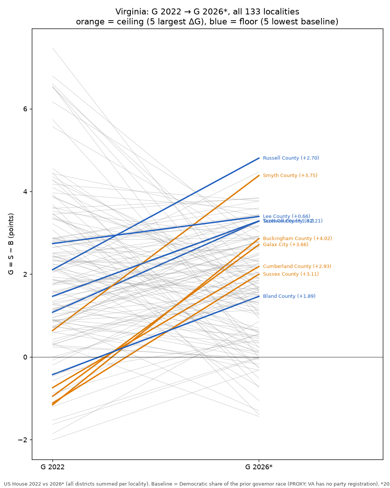
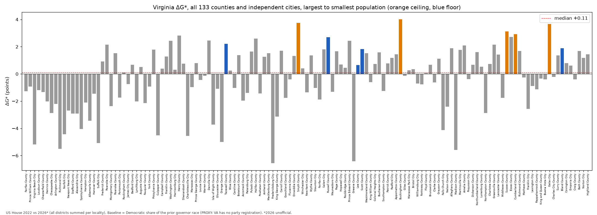
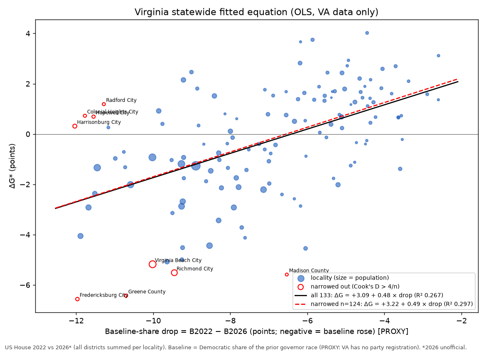
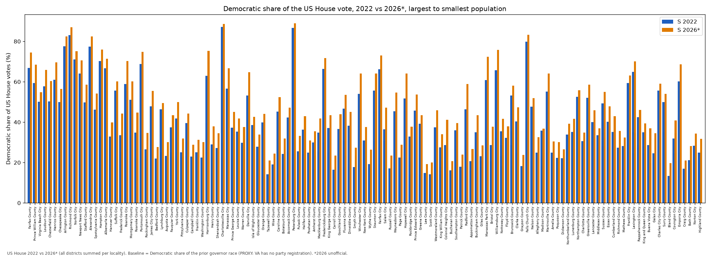
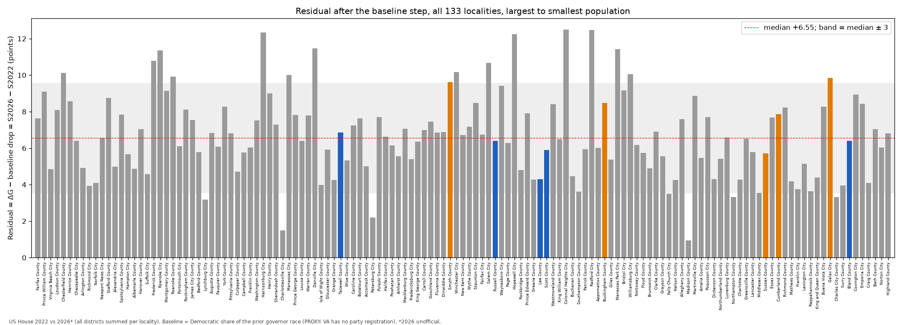
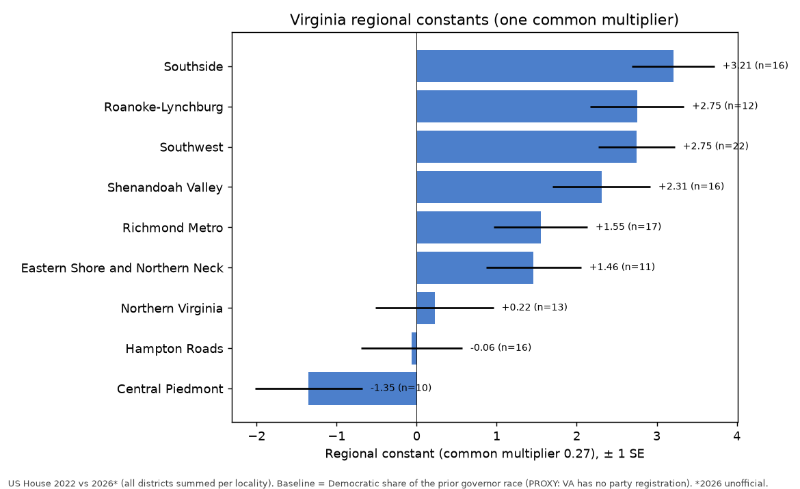
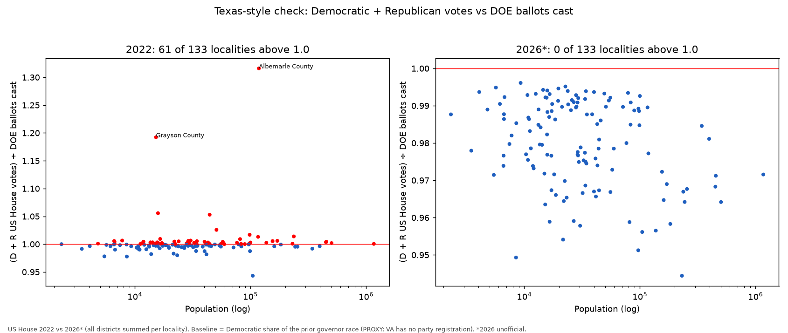

# Graphs

> **\*2026 figures are unofficial.** The Virginia State Board of Elections has not certified the November 3, 2026 general election. The Department of Elections (DOE) results site, enr.elections.virginia.gov (2026 November General), still labels them unofficial results; the files used here were published there on Nov 19, 2026 at 11:27 AM CST. 2022, 2021 and 2025 figures are certified. **PROXY BASELINE: Virginia has no party registration.** Where the other state wikis use the Democratic registration share, these pages use **B** = the Democratic share of the governor vote in the odd-year election just before each midterm (2021 for 2022, 2025 for 2026). It is not a count of registered Democrats. **Race: US House**, all 11 districts summed per county or independent city (Virginia had no governor, General Assembly or statewide race in 2022). Votes are votes for the Democratic candidate. These pages measure a pattern; they make no claim about intent, fraud or cause.

All charts use the US House race, the total-US-House-votes denominator and the governor-vote baseline [PROXY], and list localities largest to smallest population unless the title says otherwise.

## 1. Locality slope chart

_Each line is one locality, G 2022 to G 2026\*. Orange: the five ceiling localities; blue: the five floor localities; each labeled with its ΔG\*._

## 2. ΔG by population

_All 133 localities in population order. Ceiling: Buckingham County is the highest ΔG\*. Lowest: Fredericksburg City\*. Dashed red line: median +0.11._

## 3. Statewide fitted equation

_ΔG\* against baseline-share drop for all 133 localities (dot size = population). Black: all-locality fit, ΔG = +3.09 + 0.48 × drop, R² 0.267. Red dashed: narrowed fit (n = 124). Red circles: the 9 localities narrowed out._

## 4. Paired bars, 2022 vs 2026

_Democratic share of US House votes, 2022 (blue) and 2026\* (orange), all 133 localities in population order._

## 5. Residual bars

_Residual (ΔG minus baseline-share drop, equal to S2026 − S2022) for all 133 localities. Shaded band: median ± 3 points._

## 6. Regional constants

_One constant per region with a common multiplier (0.27), ± 1 standard error. These constants go with the common multiplier, so they are not comparable to the statewide constant +3.09._

## 7. Texas-style over-ballot check

_(D + R US House votes) ÷ DOE ballots cast. 2026\*: 0 of 133 above 1.0. 2022: 61 of 133 above 1.0, caused by gaps in the 2022 DOE turnout report (Albemarle and Grayson labeled)._

---
**Related:** [Floor and Ceiling Localities](Floor-and-Ceiling) · [Bottom-Up Reverse Math](Reverse-Math) · [Locked Virginia Formula](Locked-Virginia-Formula) · [Home](Home)
