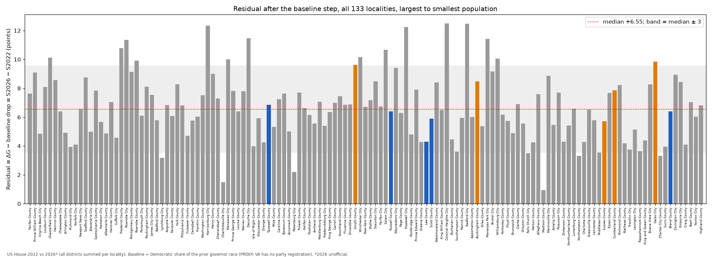

# Bottom-Up Reverse Math

> **\*2026 figures are unofficial.** The Virginia State Board of Elections has not certified the November 3, 2026 general election. The Department of Elections (DOE) results site, enr.elections.virginia.gov (2026 November General), still labels them unofficial results; the files used here were published there on Nov 19, 2026 at 11:27 AM CST. 2022, 2021 and 2025 figures are certified. **PROXY BASELINE: Virginia has no party registration.** Where the other state wikis use the Democratic registration share, these pages use **B** = the Democratic share of the governor vote in the odd-year election just before each midterm (2021 for 2022, 2025 for 2026). It is not a count of registered Democrats. **Race: US House**, all 11 districts summed per county or independent city (Virginia had no governor, General Assembly or statewide race in 2022). Votes are votes for the Democratic candidate. These pages measure a pattern; they make no claim about intent, fraud or cause.

The same arithmetic at three levels, from one locality up to the whole state, then solved backward for implied extra votes. Denominator: total votes cast in the US House race (see [Locked Virginia Formula](Locked-Virginia-Formula#denominator)). The method comes from the [Cedar County Audit](https://github.com/mbenson8989/Nebraska-Election-Analysis-/wiki/Cedar-Audit) in Nebraska.

## Step 1: Chesterfield County

| Step | Value |
|---|---|
| Democratic US House share (S) | 50.29% (2022) → 60.40%\* (2026): **+10.12 points\*** |
| Baseline B, Democratic share of prior governor vote **[PROXY]** | 47.41% (2021) → 58.86% (2025): **+11.45 points** |
| ΔG = vote-share change − baseline change | 10.12 − (+11.45) = **−1.34 points\*** |
| Reverse step: ΔG − baseline-share drop | −1.34 − (−11.45) = +10.12 (the residual) |
| Implied extra votes | 107,196\* − 50.29% × 177,464\* = **about +17,951\*** |
| Baseline-scaled gap (stand-in for the Nebraska wiki's "gap in votes" line, for comparison) | 107,196\* − 70,534 × (100,595 ÷ 74,085) = about +11,423\* |

Chesterfield's Democratic baseline rose (it did not fall), so under the Nebraska rule it is a **non-loss** locality: the residual is shown for completeness.

## Step 2: the six largest localities

Largest to smallest population (Census Vintage 2025).

| Locality | Population | B 2021 → 2025 [PROXY] | Dem US House votes 2022 → 2026\* | US House votes 2022 → 2026\* | Vote-share change\* (pts) | Baseline change (pts) | ΔG\* (pts) | Implied extra votes\* |
|---|---|---|---|---|---|---|---|---|
| Fairfax County | 1,167,873 | 64.89% → 73.78% | 271,542 → 361,541 | 406,709 → 485,973 | +7.63 | +8.89 | −1.26 | +37,078 |
| Prince William County | 502,966 | 57.01% → 67.03% | 90,113 → 127,459 | 151,592 → 185,971 | +9.09 | +10.02 | −0.93 | +16,910 |
| Virginia Beach City | 453,737 | 45.60% → 55.62% | 81,421 → 103,276 | 162,686 → 188,167 | +4.84 | +10.02 | −5.18 | +9,102 |
| Loudoun County | 449,749 | 55.25% → 64.52% | 94,116 → 121,988 | 162,979 → 185,316 | +8.08 | +9.27 | −1.19 | +14,973 |
| Chesterfield County | 397,148 | 47.41% → 58.86% | 70,534 → 107,196 | 140,257 → 177,464 | +10.12 | +11.45 | −1.34 | +17,951 |
| Henrico County | 342,775 | 58.71% → 69.30% | 76,319 → 108,138 | 125,186 → 155,511 | +8.57 | +10.59 | −2.01 | +13,332 |

ΔG is negative in all six largest localities: there the Democratic 2026 House share rose less than the 2021→2025 governor baseline did.

## Step 3: all 133 localities

| Group | Localities | Dem US House share | Baseline B [PROXY] | Vote-share change\* | Baseline change | Pooled ΔG\* | Locality median ΔG\* (range) | Implied extra votes\* |
|---|---|---|---|---|---|---|---|---|
| Six largest localities | 6 | 59.51% → 67.44%\* | 57.07% → 66.72% | +7.93 | +9.65 | −1.72 | −1.30 (−5.18 to −0.93) | +109,345 |
| Other localities | 127 | 46.79% → 53.92%\* | 43.71% → 52.20% | +7.13 | +8.49 | −1.36 | +0.31 (−6.56 to +4.02) | +148,656 |
| All Virginia localities | 133 | 51.59% → 59.02%\* | 48.64% → 57.58% | +7.43 | +8.94 | −1.50 | +0.11 (−6.56 to +4.02) | +258,001 |

Locality size explains little of the spread (R² = 0.158 against log population).

## Solving backward: implied extra votes (hypothesis)

For each locality, implied extra votes = 2026 Democratic votes − (2022 Democratic share × 2026 US House votes). That is how many more Democratic votes the locality cast than it would have at its 2022 share on 2026 turnout.

| Measure | Votes |
|---|---|
| Sum of the 133 locality figures | 258,001\* |
| Statewide, pooled: (59.02% − 51.59%) × 3,654,176 | 271,626\* |
| Raw rise in Democratic votes | +584,487\* = 271,626 share gain + 312,861 from more votes at the 2022 share |
| Localities with negative implied extra votes | 0 |
| Sum of baseline-scaled gaps (comparison line) | 209,410\* |

**No offset-need line.** In registration states this table also shows the votes needed to offset a registration-share *decline*. Virginia's baseline did not decline anywhere: statewide B rose +8.94 points from 2021 to 2025, so there is no decline to offset.

> **Hypothesis label.** Turning the residual into "implied extra votes" and calling them injected, switched or offset votes is a hypothesis the arithmetic cannot test. The same number reflects candidate choice, crossover voting, turnout changes and any other cause. Candidate votes are not turnout, and a governor-vote baseline is not a count of Democrats.

## What the arithmetic cannot tell you

- **The baseline moved more than the House vote.** Statewide, B rose +8.94 points and S rose +7.43\*, so statewide ΔG is −1.50\*.
- **The swing was near-uniform.** 110 of 133 residuals are within 3 points of the median (+6.55\*).
- **No control cycle.** The Iowa wiki compares 2018→2022. Virginia's 2018 US House map was different and District 3 was uncontested in 2018, so a matching control was not run.
- **2026 is unofficial.** These totals will be re-run after certification.

_Residual (ΔG minus baseline-share drop, equal to S2026 − S2022) for all 133 localities, largest to smallest population. Shaded band: median ± 3 points._

## All 133 localities

Largest to smallest population. S = Democratic share of US House votes; B = Democratic share of prior governor vote [PROXY]. Full precision and every input column: [data/virginia_localities_final.csv](https://github.com/mbenson8989/Virginia-Election-Analysis/blob/main/data/virginia_localities_final.csv).

| # | Locality | Region | Population | Dem 2022 | House votes 2022 | Dem 2026\* | House votes 2026\* | S 2022 | S 2026\* | B 2021 | B 2025 | ΔG\* | Residual\* | Implied extra\* |
|---|---|---|---|---|---|---|---|---|---|---|---|---|---|---|
| 1 | Fairfax County | Northern Virginia | 1,167,873 | 271,542 | 406,709 | 361,541 | 485,973 | 66.77 | 74.40 | 64.89 | 73.78 | −1.26 | +7.63 | +37,078 |
| 2 | Prince William County | Northern Virginia | 502,966 | 90,113 | 151,592 | 127,459 | 185,971 | 59.44 | 68.54 | 57.01 | 67.03 | −0.93 | +9.09 | +16,910 |
| 3 | Virginia Beach City | Hampton Roads | 453,737 | 81,421 | 162,686 | 103,276 | 188,167 | 50.05 | 54.89 | 45.60 | 55.62 | −5.18 | +4.84 | +9,102 |
| 4 | Loudoun County | Northern Virginia | 449,749 | 94,116 | 162,979 | 121,988 | 185,316 | 57.75 | 65.83 | 55.25 | 64.52 | −1.19 | +8.08 | +14,973 |
| 5 | Chesterfield County | Richmond Metro | 397,148 | 70,534 | 140,257 | 107,196 | 177,464 | 50.29 | 60.40 | 47.41 | 58.86 | −1.34 | +10.12 | +17,951 |
| 6 | Henrico County | Richmond Metro | 342,775 | 76,319 | 125,186 | 108,138 | 155,511 | 60.96 | 69.54 | 58.71 | 69.30 | −2.01 | +8.57 | +13,332 |
| 7 | Chesapeake City | Hampton Roads | 255,332 | 44,335 | 88,647 | 58,054 | 102,926 | 50.01 | 56.40 | 46.79 | 56.06 | −2.87 | +6.39 | +6,578 |
| 8 | Arlington County | Northern Virginia | 243,931 | 70,856 | 91,336 | 88,771 | 107,596 | 77.58 | 82.50 | 76.67 | 83.81 | −2.21 | +4.93 | +5,301 |
| 9 | Richmond City | Richmond Metro | 237,257 | 57,568 | 69,347 | 83,754 | 96,323 | 83.01 | 86.95 | 77.27 | 86.73 | −5.51 | +3.94 | +3,792 |
| 10 | Norfolk City | Hampton Roads | 231,013 | 38,638 | 54,372 | 52,081 | 69,291 | 71.06 | 75.16 | 67.14 | 75.68 | −4.44 | +4.10 | +2,841 |
| 11 | Newport News City | Hampton Roads | 183,230 | 31,834 | 49,705 | 42,205 | 59,784 | 64.05 | 70.60 | 59.69 | 68.93 | −2.68 | +6.55 | +3,916 |
| 12 | Stafford County | Northern Virginia | 170,803 | 28,685 | 57,637 | 39,744 | 67,907 | 49.77 | 58.53 | 44.20 | 55.88 | −2.92 | +8.76 | +5,948 |
| 13 | Alexandria City | Northern Virginia | 160,662 | 41,974 | 54,226 | 56,463 | 68,529 | 77.41 | 82.39 | 75.20 | 83.11 | −2.92 | +4.99 | +3,418 |
| 14 | Spotsylvania County | Northern Virginia | 155,388 | 25,424 | 54,956 | 34,063 | 62,970 | 46.26 | 54.09 | 39.47 | 51.36 | −4.06 | +7.83 | +4,932 |
| 15 | Hampton City | Hampton Roads | 137,315 | 28,593 | 40,656 | 38,318 | 50,418 | 70.33 | 76.00 | 66.45 | 74.23 | −2.11 | +5.67 | +2,859 |
| 16 | Albemarle County | Central Piedmont | 118,356 | 33,437 | 50,206 | 43,002 | 60,171 | 66.60 | 71.47 | 62.05 | 70.35 | −3.44 | +4.87 | +2,928 |
| 17 | Hanover County | Richmond Metro | 116,423 | 17,054 | 51,937 | 24,567 | 61,604 | 32.84 | 39.88 | 31.24 | 39.75 | −1.46 | +7.04 | +4,339 |
| 18 | Suffolk City | Hampton Roads | 104,699 | 20,475 | 36,797 | 27,834 | 46,228 | 55.64 | 60.21 | 51.96 | 61.60 | −5.07 | +4.57 | +2,111 |
| 19 | Frederick County | Shenandoah Valley | 99,955 | 11,302 | 33,693 | 18,109 | 40,861 | 33.54 | 44.32 | 30.69 | 40.55 | +0.92 | +10.77 | +4,403 |
| 20 | Roanoke City | Roanoke-Lynchburg | 99,111 | 15,482 | 26,321 | 23,115 | 32,934 | 58.82 | 70.19 | 57.70 | 66.91 | +2.15 | +11.37 | +3,743 |
| 21 | Montgomery County | Southwest | 98,434 | 14,239 | 27,871 | 23,315 | 38,706 | 51.09 | 60.24 | 46.82 | 58.34 | −2.37 | +9.15 | +3,541 |
| 22 | Roanoke County | Roanoke-Lynchburg | 97,150 | 13,036 | 37,404 | 19,920 | 44,486 | 34.85 | 44.78 | 33.70 | 42.12 | +1.51 | +9.93 | +4,416 |
| 23 | Portsmouth City | Hampton Roads | 96,777 | 18,770 | 27,301 | 24,552 | 32,800 | 68.75 | 74.85 | 65.41 | 73.25 | −1.74 | +6.10 | +2,001 |
| 24 | Rockingham County | Shenandoah Valley | 89,316 | 8,392 | 31,535 | 13,140 | 37,847 | 26.61 | 34.72 | 24.11 | 32.11 | +0.11 | +8.11 | +3,068 |
| 25 | James City County | Hampton Roads | 83,326 | 18,090 | 37,803 | 24,449 | 44,133 | 47.85 | 55.40 | 46.98 | 55.28 | −0.75 | +7.55 | +3,330 |
| 26 | Bedford County | Roanoke-Lynchburg | 83,059 | 7,389 | 33,689 | 11,263 | 40,622 | 21.93 | 27.73 | 20.47 | 25.59 | +0.68 | +5.79 | +2,353 |
| 27 | Lynchburg City | Roanoke-Lynchburg | 81,347 | 10,840 | 23,420 | 15,451 | 31,232 | 46.29 | 49.47 | 44.17 | 49.38 | −2.02 | +3.19 | +995 |
| 28 | Augusta County | Shenandoah Valley | 78,940 | 7,089 | 30,487 | 10,480 | 34,827 | 23.25 | 30.09 | 21.51 | 27.85 | +0.50 | +6.84 | +2,382 |
| 29 | Fauquier County | Northern Virginia | 76,503 | 12,408 | 33,157 | 15,325 | 35,221 | 37.42 | 43.51 | 34.04 | 42.27 | −2.14 | +6.09 | +2,145 |
| 30 | York County | Hampton Roads | 71,374 | 11,640 | 27,887 | 16,686 | 33,360 | 41.74 | 50.02 | 40.85 | 50.06 | −0.93 | +8.28 | +2,762 |
| 31 | Pittsylvania County | Southside | 59,490 | 5,994 | 23,931 | 8,427 | 26,442 | 25.05 | 31.87 | 24.35 | 29.38 | +1.79 | +6.82 | +1,804 |
| 32 | Culpeper County | Central Piedmont | 57,666 | 7,979 | 20,217 | 9,961 | 22,543 | 39.47 | 44.19 | 32.95 | 42.19 | −4.52 | +4.72 | +1,064 |
| 33 | Campbell County | Roanoke-Lynchburg | 55,629 | 4,616 | 20,060 | 7,086 | 24,621 | 23.01 | 28.78 | 21.22 | 26.60 | +0.38 | +5.77 | +1,420 |
| 34 | Franklin County | Roanoke-Lynchburg | 55,526 | 5,131 | 20,412 | 7,448 | 23,893 | 25.14 | 31.17 | 24.71 | 29.48 | +1.27 | +6.04 | +1,442 |
| 35 | Washington County | Southwest | 53,898 | 4,047 | 17,970 | 6,355 | 21,148 | 22.52 | 30.05 | 20.48 | 25.58 | +2.43 | +7.53 | +1,592 |
| 36 | Harrisonburg City | Shenandoah Valley | 50,839 | 6,526 | 10,368 | 11,116 | 14,764 | 62.94 | 75.29 | 60.09 | 72.12 | +0.31 | +12.35 | +1,823 |
| 37 | Henry County | Southside | 49,242 | 4,486 | 15,486 | 6,941 | 18,277 | 28.97 | 37.98 | 29.93 | 36.11 | +2.82 | +9.01 | +1,647 |
| 38 | Shenandoah County | Shenandoah Valley | 45,839 | 4,387 | 16,173 | 6,438 | 18,700 | 27.13 | 34.43 | 24.72 | 31.27 | +0.75 | +7.30 | +1,366 |
| 39 | Charlottesville City | Central Piedmont | 44,388 | 14,581 | 16,727 | 19,195 | 21,648 | 87.17 | 88.67 | 82.88 | 88.93 | −4.55 | +1.50 | +324 |
| 40 | Manassas City | Northern Virginia | 44,332 | 6,029 | 10,653 | 8,717 | 13,087 | 56.59 | 66.61 | 54.44 | 65.42 | −0.97 | +10.01 | +1,310 |
| 41 | Prince George County | Richmond Metro | 43,936 | 4,163 | 11,172 | 5,961 | 13,226 | 37.26 | 45.07 | 34.62 | 41.64 | +0.79 | +7.81 | +1,033 |
| 42 | Louisa County | Central Piedmont | 42,924 | 5,762 | 16,297 | 8,126 | 19,465 | 35.36 | 41.75 | 33.43 | 40.25 | −0.43 | +6.39 | +1,244 |
| 43 | Warren County | Shenandoah Valley | 42,740 | 4,253 | 14,248 | 6,365 | 16,907 | 29.85 | 37.65 | 27.53 | 35.47 | −0.14 | +7.80 | +1,318 |
| 44 | Danville City | Southside | 41,647 | 6,208 | 11,664 | 9,228 | 14,264 | 53.22 | 64.69 | 53.42 | 62.43 | +2.46 | +11.47 | +1,636 |
| 45 | Isle of Wight County | Hampton Roads | 41,321 | 7,158 | 18,533 | 8,907 | 20,904 | 38.62 | 42.61 | 35.16 | 42.86 | −3.72 | +3.99 | +833 |
| 46 | Gloucester County | Hampton Roads | 40,097 | 4,306 | 15,458 | 6,105 | 18,077 | 27.86 | 33.77 | 27.09 | 34.09 | −1.08 | +5.92 | +1,069 |
| 47 | Orange County | Central Piedmont | 40,083 | 6,432 | 16,155 | 7,750 | 17,583 | 39.81 | 44.08 | 33.22 | 42.47 | −4.99 | +4.26 | +749 |
| 48 | Tazewell County | Southwest | 38,635 | 1,635 | 11,538 | 2,774 | 13,197 | 14.17 | 21.02 | 13.09 | 17.73 | +2.21 | +6.85 | +904 |
| 49 | Wise County | Southwest | 34,824 | 1,783 | 9,315 | 2,692 | 10,998 | 19.14 | 24.48 | 15.55 | 20.65 | +0.24 | +5.34 | +587 |
| 50 | Caroline County | Eastern Shore and Northern Neck | 34,413 | 5,244 | 11,609 | 7,187 | 13,709 | 45.17 | 52.43 | 41.83 | 50.11 | −1.03 | +7.25 | +994 |
| 51 | Botetourt County | Roanoke-Lynchburg | 34,144 | 3,568 | 14,707 | 5,560 | 17,437 | 24.26 | 31.89 | 23.30 | 29.54 | +1.38 | +7.63 | +1,330 |
| 52 | Accomack County | Eastern Shore and Northern Neck | 33,859 | 5,569 | 13,189 | 6,719 | 14,222 | 42.22 | 47.24 | 38.37 | 45.35 | −1.97 | +5.02 | +714 |
| 53 | Petersburg City | Richmond Metro | 33,734 | 6,592 | 7,600 | 9,097 | 10,228 | 86.74 | 88.94 | 84.87 | 88.46 | −1.39 | +2.21 | +226 |
| 54 | Pulaski County | Southwest | 33,586 | 2,768 | 10,859 | 4,300 | 12,951 | 25.49 | 33.20 | 25.20 | 31.28 | +1.63 | +7.71 | +999 |
| 55 | Halifax County | Southside | 33,447 | 4,374 | 12,071 | 5,997 | 13,987 | 36.24 | 42.88 | 35.53 | 39.58 | +2.59 | +6.64 | +929 |
| 56 | Powhatan County | Richmond Metro | 32,591 | 3,711 | 14,931 | 5,289 | 17,059 | 24.85 | 31.00 | 22.73 | 30.31 | −1.43 | +6.15 | +1,049 |
| 57 | Amherst County | Roanoke-Lynchburg | 31,962 | 3,536 | 11,802 | 4,994 | 14,065 | 29.96 | 35.51 | 28.43 | 32.72 | +1.26 | +5.55 | +780 |
| 58 | Mecklenburg County | Southside | 30,747 | 3,869 | 11,120 | 5,386 | 12,866 | 34.79 | 41.86 | 33.85 | 39.40 | +1.52 | +7.07 | +910 |
| 59 | Fredericksburg City | Northern Virginia | 30,393 | 6,082 | 9,169 | 7,863 | 10,961 | 66.33 | 71.74 | 59.79 | 71.76 | −6.56 | +5.40 | +592 |
| 60 | King George County | Eastern Shore and Northern Neck | 29,646 | 3,913 | 10,530 | 5,201 | 11,951 | 37.16 | 43.52 | 31.00 | 40.50 | −3.14 | +6.36 | +760 |
| 61 | Carroll County | Southwest | 29,299 | 1,685 | 10,210 | 2,758 | 11,740 | 16.50 | 23.49 | 16.15 | 21.44 | +1.70 | +6.99 | +820 |
| 62 | Goochland County | Richmond Metro | 29,187 | 5,028 | 13,758 | 7,775 | 17,673 | 36.55 | 43.99 | 33.74 | 42.95 | −1.76 | +7.45 | +1,316 |
| 63 | Fluvanna County | Central Piedmont | 28,975 | 5,516 | 11,832 | 7,473 | 13,975 | 46.62 | 53.47 | 42.65 | 49.91 | −0.40 | +6.85 | +958 |
| 64 | Dinwiddie County | Richmond Metro | 28,896 | 3,639 | 9,535 | 5,165 | 11,467 | 38.16 | 45.04 | 36.10 | 41.65 | +1.32 | +6.88 | +789 |
| 65 | Smyth County | Southwest | 28,882 | 1,496 | 8,457 | 2,786 | 10,205 | 17.69 | 27.30 | 17.05 | 22.92 | +3.75 | +9.61 | +981 |
| 66 | Winchester City | Shenandoah Valley | 28,272 | 4,263 | 7,896 | 6,079 | 9,476 | 53.99 | 64.15 | 50.54 | 60.30 | +0.40 | +10.16 | +963 |
| 67 | New Kent County | Richmond Metro | 28,022 | 3,417 | 11,071 | 5,321 | 14,160 | 30.86 | 37.58 | 28.50 | 36.56 | −1.35 | +6.71 | +951 |
| 68 | Wythe County | Southwest | 27,983 | 1,824 | 9,491 | 2,931 | 11,101 | 19.22 | 26.40 | 17.67 | 23.49 | +1.36 | +7.18 | +798 |
| 69 | Staunton City | Shenandoah Valley | 26,801 | 5,081 | 9,131 | 7,254 | 11,311 | 55.65 | 64.13 | 51.21 | 60.73 | −1.04 | +8.49 | +960 |
| 70 | Fairfax City | Northern Virginia | 26,772 | 6,384 | 9,643 | 8,256 | 11,317 | 66.20 | 72.95 | 63.74 | 72.37 | −1.88 | +6.75 | +764 |
| 71 | Salem City | Roanoke-Lynchburg | 25,816 | 3,040 | 8,341 | 4,678 | 9,930 | 36.45 | 47.11 | 34.99 | 43.85 | +1.81 | +10.66 | +1,059 |
| 72 | Russell County | Southwest | 25,332 | 1,337 | 7,829 | 2,138 | 9,105 | 17.08 | 23.48 | 14.97 | 18.68 | +2.70 | +6.40 | +583 |
| 73 | Waynesboro City | Shenandoah Valley | 23,951 | 3,264 | 7,204 | 5,008 | 9,153 | 45.31 | 54.71 | 41.69 | 52.42 | −1.32 | +9.41 | +861 |
| 74 | Page County | Shenandoah Valley | 23,762 | 1,847 | 8,212 | 2,744 | 9,535 | 22.49 | 28.78 | 20.73 | 25.35 | +1.67 | +6.29 | +599 |
| 75 | Hopewell City | Richmond Metro | 23,261 | 2,692 | 5,197 | 4,272 | 6,671 | 51.80 | 64.04 | 49.16 | 60.70 | +0.69 | +12.24 | +816 |
| 76 | Rockbridge County | Shenandoah Valley | 22,663 | 2,964 | 9,019 | 3,871 | 10,275 | 32.86 | 37.67 | 30.64 | 35.00 | +0.45 | +4.81 | +494 |
| 77 | Prince Edward County | Southside | 22,391 | 2,918 | 6,374 | 4,255 | 7,924 | 45.78 | 53.70 | 45.05 | 50.53 | +2.44 | +7.92 | +627 |
| 78 | Greene County | Central Piedmont | 21,958 | 3,307 | 8,436 | 4,337 | 9,975 | 39.20 | 43.48 | 31.73 | 42.44 | −6.43 | +4.28 | +427 |
| 79 | Lee County | Southwest | 21,642 | 842 | 5,664 | 1,233 | 6,436 | 14.87 | 19.16 | 12.13 | 15.76 | +0.66 | +4.29 | +276 |
| 80 | Scott County | Southwest | 21,200 | 928 | 6,543 | 1,508 | 7,509 | 14.18 | 20.08 | 12.72 | 16.80 | +1.82 | +5.90 | +443 |
| 81 | Westmoreland County | Eastern Shore and Northern Neck | 19,715 | 2,642 | 7,053 | 4,065 | 8,861 | 37.46 | 45.88 | 38.99 | 45.88 | +1.53 | +8.42 | +746 |
| 82 | King William County | Richmond Metro | 19,617 | 2,074 | 7,549 | 3,098 | 9,121 | 27.47 | 33.97 | 26.21 | 33.32 | −0.61 | +6.49 | +592 |
| 83 | Colonial Heights City | Richmond Metro | 18,738 | 1,618 | 5,645 | 2,661 | 6,465 | 28.66 | 41.16 | 25.79 | 37.56 | +0.73 | +12.50 | +808 |
| 84 | Buchanan County | Southwest | 18,492 | 767 | 4,745 | 1,132 | 5,486 | 16.16 | 20.63 | 15.05 | 17.94 | +1.58 | +4.47 | +245 |
| 85 | Southampton County | Hampton Roads | 18,110 | 2,666 | 7,409 | 3,041 | 7,679 | 35.98 | 39.60 | 34.68 | 39.56 | −1.26 | +3.62 | +278 |
| 86 | Patrick County | Southside | 17,424 | 1,065 | 5,941 | 1,662 | 6,965 | 17.93 | 23.86 | 17.34 | 22.50 | +0.77 | +5.94 | +413 |
| 87 | Radford City | Southwest | 17,243 | 1,744 | 3,760 | 3,055 | 5,191 | 46.38 | 58.85 | 44.80 | 56.08 | +1.19 | +12.47 | +647 |
| 88 | Appomattox County | Roanoke-Lynchburg | 17,172 | 1,364 | 6,597 | 2,102 | 7,876 | 20.68 | 26.69 | 19.33 | 23.90 | +1.44 | +6.01 | +474 |
| 89 | Buckingham County | Southside | 17,137 | 1,869 | 5,347 | 2,733 | 6,294 | 34.95 | 43.42 | 36.11 | 40.56 | +4.02 | +8.47 | +533 |
| 90 | Giles County | Southwest | 16,564 | 1,337 | 5,785 | 1,894 | 6,650 | 23.11 | 28.48 | 20.77 | 26.28 | −0.14 | +5.37 | +357 |
| 91 | Manassas Park City | Northern Virginia | 16,560 | 2,041 | 3,353 | 3,361 | 4,649 | 60.87 | 72.30 | 59.99 | 71.16 | +0.26 | +11.42 | +531 |
| 92 | Bristol City | Southwest | 16,418 | 1,259 | 4,403 | 1,893 | 5,014 | 28.59 | 37.75 | 26.07 | 34.90 | +0.34 | +9.16 | +459 |
| 93 | Williamsburg City | Hampton Roads | 15,861 | 3,352 | 5,098 | 5,657 | 7,463 | 65.75 | 75.80 | 64.59 | 75.35 | −0.71 | +10.05 | +750 |
| 94 | Nottoway County | Southside | 15,796 | 1,713 | 4,821 | 2,186 | 5,241 | 35.53 | 41.71 | 34.93 | 41.88 | −0.77 | +6.18 | +324 |
| 95 | Floyd County | Southwest | 15,789 | 2,005 | 6,227 | 2,864 | 7,550 | 32.20 | 37.93 | 29.38 | 35.06 | +0.06 | +5.74 | +433 |
| 96 | Brunswick County | Southside | 15,727 | 2,791 | 5,246 | 3,481 | 5,991 | 53.20 | 58.10 | 52.02 | 56.25 | +0.67 | +4.90 | +294 |
| 97 | Clarke County | Shenandoah Valley | 15,609 | 2,902 | 7,179 | 3,710 | 7,840 | 40.42 | 47.32 | 36.90 | 44.42 | −0.62 | +6.90 | +541 |
| 98 | Grayson County | Southwest | 15,230 | 985 | 5,384 | 1,463 | 6,136 | 18.29 | 23.84 | 17.03 | 21.46 | +1.11 | +5.55 | +340 |
| 99 | Falls Church City | Northern Virginia | 15,159 | 5,134 | 6,437 | 6,818 | 8,190 | 79.76 | 83.25 | 76.69 | 84.30 | −4.13 | +3.49 | +286 |
| 100 | Nelson County | Central Piedmont | 14,920 | 3,405 | 7,144 | 4,061 | 7,822 | 47.66 | 51.92 | 43.57 | 50.23 | −2.40 | +4.26 | +333 |
| 101 | Alleghany County | Roanoke-Lynchburg | 14,546 | 1,347 | 5,411 | 1,910 | 5,882 | 24.89 | 32.47 | 24.97 | 30.67 | +1.88 | +7.58 | +446 |
| 102 | Madison County | Central Piedmont | 14,237 | 2,320 | 6,471 | 2,443 | 6,639 | 35.85 | 36.80 | 29.33 | 35.86 | −5.59 | +0.95 | +63 |
| 103 | Martinsville City | Southside | 13,849 | 2,032 | 3,683 | 2,717 | 4,243 | 55.17 | 64.03 | 56.38 | 63.48 | +1.76 | +8.86 | +376 |
| 104 | Amelia County | Richmond Metro | 13,632 | 1,393 | 5,584 | 1,958 | 6,437 | 24.95 | 30.42 | 25.42 | 28.79 | +2.10 | +5.47 | +352 |
| 105 | Poquoson City | Hampton Roads | 13,292 | 1,250 | 5,586 | 1,925 | 6,401 | 22.38 | 30.07 | 21.66 | 29.73 | −0.38 | +7.70 | +493 |
| 106 | Dickenson County | Southwest | 13,236 | 864 | 3,897 | 1,329 | 5,019 | 22.17 | 26.48 | 19.40 | 23.04 | +0.67 | +4.31 | +216 |
| 107 | Northumberland County | Eastern Shore and Northern Neck | 12,557 | 2,093 | 6,183 | 2,748 | 6,998 | 33.85 | 39.27 | 35.48 | 39.29 | +1.60 | +5.42 | +379 |
| 108 | Lunenburg County | Southside | 12,058 | 1,440 | 4,100 | 1,924 | 4,613 | 35.12 | 41.71 | 34.09 | 40.14 | +0.53 | +6.59 | +304 |
| 109 | Northampton County | Eastern Shore and Northern Neck | 11,879 | 2,855 | 5,434 | 3,364 | 6,023 | 52.54 | 55.85 | 49.09 | 55.26 | −2.86 | +3.31 | +200 |
| 110 | Charlotte County | Southside | 11,401 | 1,301 | 4,257 | 1,685 | 4,835 | 30.56 | 34.85 | 29.24 | 32.80 | +0.73 | +4.29 | +207 |
| 111 | Greensville County | Southside | 11,181 | 1,527 | 2,933 | 1,939 | 3,310 | 52.06 | 58.58 | 52.64 | 57.00 | +2.16 | +6.52 | +216 |
| 112 | Lancaster County | Eastern Shore and Northern Neck | 10,995 | 2,188 | 5,457 | 2,868 | 6,250 | 40.10 | 45.89 | 40.97 | 45.34 | +1.42 | +5.79 | +362 |
| 113 | Middlesex County | Eastern Shore and Northern Neck | 10,841 | 1,716 | 5,128 | 2,193 | 5,924 | 33.46 | 37.02 | 33.14 | 38.46 | −1.76 | +3.56 | +211 |
| 114 | Sussex County | Richmond Metro | 10,755 | 1,689 | 3,428 | 2,086 | 3,794 | 49.27 | 54.98 | 50.39 | 52.98 | +3.11 | +5.71 | +217 |
| 115 | Essex County | Eastern Shore and Northern Neck | 10,654 | 1,696 | 4,220 | 2,402 | 5,018 | 40.19 | 47.87 | 42.05 | 47.01 | +2.71 | +7.68 | +385 |
| 116 | Cumberland County | Southside | 10,352 | 1,307 | 3,722 | 1,916 | 4,458 | 35.12 | 42.98 | 35.86 | 40.79 | +2.93 | +7.86 | +351 |
| 117 | Richmond County | Eastern Shore and Northern Neck | 9,294 | 764 | 2,788 | 1,186 | 3,328 | 27.40 | 35.64 | 29.41 | 35.96 | +1.68 | +8.23 | +274 |
| 118 | Mathews County | Hampton Roads | 8,529 | 1,239 | 4,399 | 1,544 | 4,771 | 28.17 | 32.36 | 27.92 | 32.38 | −0.26 | +4.20 | +200 |
| 119 | Franklin City | Hampton Roads | 8,478 | 1,730 | 2,913 | 2,137 | 3,384 | 59.39 | 63.15 | 56.66 | 63.00 | −2.58 | +3.76 | +127 |
| 120 | Lexington City | Shenandoah Valley | 7,769 | 1,312 | 2,022 | 1,571 | 2,243 | 64.89 | 70.04 | 62.03 | 68.07 | −0.88 | +5.15 | +116 |
| 121 | Rappahannock County | Central Piedmont | 7,439 | 1,722 | 4,061 | 1,895 | 4,115 | 42.40 | 46.05 | 39.98 | 44.75 | −1.12 | +3.65 | +150 |
| 122 | King and Queen County | Eastern Shore and Northern Neck | 6,743 | 1,023 | 2,928 | 1,322 | 3,362 | 34.94 | 39.32 | 34.65 | 39.38 | −0.34 | +4.38 | +147 |
| 123 | Buena Vista City | Shenandoah Valley | 6,672 | 466 | 1,625 | 727 | 1,967 | 28.68 | 36.96 | 24.50 | 33.19 | −0.40 | +8.28 | +163 |
| 124 | Galax City | Southwest | 6,670 | 395 | 1,606 | 666 | 1,934 | 24.60 | 34.44 | 25.55 | 31.72 | +3.66 | +9.84 | +190 |
| 125 | Charles City County | Richmond Metro | 6,623 | 1,585 | 2,848 | 1,998 | 3,388 | 55.65 | 58.97 | 53.79 | 57.33 | −0.22 | +3.32 | +112 |
| 126 | Surry County | Richmond Metro | 6,603 | 1,659 | 3,320 | 1,921 | 3,562 | 49.97 | 53.93 | 49.66 | 52.26 | +1.36 | +3.96 | +141 |
| 127 | Bland County | Southwest | 6,151 | 296 | 2,225 | 492 | 2,497 | 13.30 | 19.70 | 13.73 | 18.24 | +1.89 | +6.40 | +160 |
| 128 | Covington City | Roanoke-Lynchburg | 5,680 | 474 | 1,486 | 713 | 1,746 | 31.90 | 40.84 | 32.29 | 40.43 | +0.80 | +8.94 | +156 |
| 129 | Emporia City | Southside | 5,447 | 840 | 1,395 | 1,209 | 1,761 | 60.22 | 68.65 | 59.33 | 67.17 | +0.61 | +8.44 | +149 |
| 130 | Craig County | Southwest | 4,800 | 350 | 2,070 | 491 | 2,338 | 16.91 | 21.00 | 16.00 | 20.49 | −0.40 | +4.09 | +96 |
| 131 | Bath County | Shenandoah Valley | 4,076 | 358 | 1,691 | 532 | 1,886 | 21.17 | 28.21 | 20.34 | 25.69 | +1.69 | +7.04 | +133 |
| 132 | Norton City | Southwest | 3,477 | 266 | 938 | 366 | 1,064 | 28.36 | 34.40 | 26.60 | 31.47 | +1.17 | +6.04 | +64 |
| 133 | Highland County | Shenandoah Valley | 2,318 | 297 | 1,191 | 383 | 1,206 | 24.94 | 31.76 | 24.94 | 30.32 | +1.45 | +6.82 | +82 |

---
**Related:** [Locked Virginia Formula](Locked-Virginia-Formula) · [Floor and Ceiling Localities](Floor-and-Ceiling) · [Graphs](Graphs) · [Home](Home)
